# PawSpot 🐾 — ระบบตามหาสัตว์เลี้ยงสูญหาย

> Mini Project · เว็บแอปพลิเคชันกลางสำหรับ **แจ้งสัตว์เลี้ยงหาย** และ **แจ้งพบสัตว์หลง**
> พร้อมแผนที่ ระบบจับคู่ประกาศอัตโนมัติ การแจ้งเตือน และระบบผู้ดูแล

| | |
|---|---|
| **ผู้จัดทำ** | Passwich Suksumak · รหัสนักศึกษา 67111962 |
| **GitHub** | https://github.com/67111962-collab/AJ.hathairat/tree/pawspot-online/pawspot-project |
| **เทคโนโลยีหลัก** | HTML · CSS (Tailwind) · JavaScript · Node.js · Express · PostgreSQL |


---

## สารบัญ
1. [วัตถุประสงค์](#1-วัตถุประสงค์)
2. [ฟีเจอร์](#2-ฟีเจอร์)
3. [เครื่องมือและเทคโนโลยี](#3-เครื่องมือและเทคโนโลยี)
4. [โครงสร้างและการทำงานของระบบ](#4-โครงสร้างและการทำงานของระบบ)
5. [การติดตั้งและใช้งาน](#5-การติดตั้งและใช้งาน)
6. [วิธีใช้งานเว็บ](#6-วิธีใช้งานเว็บ)
7. [ฐานข้อมูล](#7-ฐานข้อมูล)
8. [API](#8-api)
9. [การทดสอบ](#9-การทดสอบ)
10. [ภาพตัวอย่างการทำงาน](#10-ภาพตัวอย่างการทำงาน)
11. [เข้าสู่ระบบด้วย Google / LINE](#11-เข้าสู่ระบบด้วย-google--line-ไม่บังคับ)
12. [ขึ้นเว็บจริง (Render + Neon)](#12-ขึ้นเว็บจริง-render--neon)
13. [สรุปผลและแนวทางปรับปรุง](#13-สรุปผลและแนวทางปรับปรุง)

---

## 1. วัตถุประสงค์

- เป็น **ศูนย์กลาง** ให้เจ้าของสัตว์เลี้ยงที่หาย กับคนที่พบสัตว์หลง ได้เจอกันเร็วที่สุด (แทนการโพสต์กระจัดกระจายในโซเชียล)
- ช่วยให้ **ค้นหาง่าย** ด้วยตัวกรอง การค้นหา และ **แผนที่** ที่เห็นว่าน้องหาย/ถูกพบที่ไหน
- ใช้ระบบ **จับคู่อัตโนมัติ** แจ้งเตือนเมื่อมีประกาศ "หาย" กับ "พบ" ที่อาจเป็นน้องตัวเดียวกัน
- ลด **ประกาศปลอม/มิจฉาชีพ** ด้วยการอนุมัติประกาศ การรายงาน และแดชบอร์ดผู้ดูแล
- ฝึกพัฒนาเว็บแบบครบวงจร: Frontend, Backend (REST API), ฐานข้อมูล, ระบบล็อกอิน และการ deploy

## 2. ฟีเจอร์

| หมวด | ฟีเจอร์ |
|---|---|
| **ประกาศ** | ลงประกาศสัตว์หาย / พบสัตว์หลง พร้อมรูป (ย่อรูปอัตโนมัติ) · ค้นหา · กรองหมวด/สถานะ · เรียงลำดับ · โหลดเพิ่มทีละหน้า |
| **แผนที่** | ปักหมุดตำแหน่ง · **ค้นหาสถานที่แล้วปักหมุด** · ใช้ตำแหน่งปัจจุบัน · ดูทุกประกาศบนแผนที่ · แผนที่เล็กในหน้ารายละเอียด |
| **จับคู่อัตโนมัติ** | ประกาศ "หาย" ↔ "พบ" ประเภทเดียวกัน ห่างไม่เกิน 5 กม. วันที่ต่างกันไม่เกิน 21 วัน → แจ้งเตือนทั้งสองฝั่ง |
| **เบาะแส** | ผู้พบเห็นแจ้งเบาะแสในประกาศ · เจ้าของได้รับแจ้งเตือน |
| **ช่วยกระจายข่าว** | แชร์ลิงก์ประกาศ · พิมพ์โปสเตอร์ "ตามหา!" ขนาด A4 |
| **บัญชีผู้ใช้** | สมัคร/ล็อกอินด้วยชื่อผู้ใช้หรืออีเมล + รหัสผ่าน · **Google** · **LINE** · โปรไฟล์ (ชื่อ อีเมล รูป รหัสผ่าน) · ประกาศของฉัน · เบาะแสที่ฉันส่ง |
| **การแจ้งเตือน** | กระดิ่งแจ้งเตือน: เบาะแสใหม่, ประกาศที่อาจตรงกัน, อนุมัติ/ไม่อนุมัติ, ประกาศถูกซ่อน |
| **ความปลอดภัย** | รหัสผ่านเข้ารหัส bcrypt · JWT · จำกัดการเดารหัส · ป้องกัน XSS / SQL Injection · แจ้งประกาศไม่เหมาะสม |
| **ผู้ดูแล (Admin)** | แดชบอร์ด + กราฟ 30 วัน · **อนุมัติประกาศก่อนขึ้นเว็บ** · ตรวจรายงาน · ซ่อน/ลบประกาศ · ตั้งผู้ดูแล/ระงับผู้ใช้ · ประวัติการเข้าสู่ระบบ |
| **การใช้งาน** | รองรับมือถือ · เมนู ☰ แบ่งหมวดตามสิทธิ์ · **โหมดมืด** · หน้าเกี่ยวกับเรา / นโยบายความเป็นส่วนตัว / ข้อตกลง / ติดต่อเรา |

## 3. เครื่องมือและเทคโนโลยี

| ส่วน | เทคโนโลยี | ใช้ทำอะไร |
|---|---|---|
| Frontend | HTML5, CSS3, **Tailwind CSS** (CDN) | หน้าเว็บ + รองรับมือถือ + โหมดมืด |
| | **JavaScript** (ไม่ใช้ framework) | การทำงานของหน้าเว็บ, เรียก API ด้วย Fetch |
| | **Leaflet** + **OpenStreetMap** / Nominatim | แผนที่ ปักหมุด และค้นหาสถานที่ |
| | Font Awesome, Google Fonts (Prompt) | ไอคอน, ฟอนต์ภาษาไทย |
| Backend | **Node.js 20+**, **Express 5** | REST API + ส่งไฟล์หน้าเว็บ |
| | **pg** (node-postgres) | เขียน SQL ติดต่อ PostgreSQL |
| | **bcryptjs**, **jsonwebtoken** | เข้ารหัสรหัสผ่าน, token เข้าสู่ระบบ |
| | OAuth 2.0 | เข้าสู่ระบบด้วย Google / LINE |
| Database | **PostgreSQL 18** + **pgAdmin 4** | เก็บข้อมูลทั้งหมด |
| เครื่องมือ | Git + GitHub, VS Code, Postman | จัดการโค้ด, ทดสอบ API |
| Deploy | Render (เซิร์ฟเวอร์), Neon (PostgreSQL) | ขึ้นเว็บจริงแบบฟรี (`render.yaml`) |

## 4. โครงสร้างและการทำงานของระบบ

```
┌──────────────────────┐   HTTP / JSON (Fetch)   ┌──────────────────────────┐   SQL   ┌──────────────┐
│  Frontend (เบราว์เซอร์) │ ──────────────────────▶ │  Backend  Node.js+Express │ ──────▶ │  PostgreSQL  │
│  HTML / CSS / JS     │ ◀────────────────────── │  /api/...  (REST API)     │ ◀────── │  (pgAdmin)   │
│  Leaflet แผนที่       │                          │  JWT · bcrypt · validation │         └──────────────┘
└──────────────────────┘                          └────────────┬─────────────┘
                                                               │ OAuth / ค้นหาสถานที่
                                                   Google · LINE · OpenStreetMap
```

**ลำดับการทำงานหลัก (ตัวอย่าง: ลงประกาศ)**
1. ผู้ใช้กรอกฟอร์ม + ปักหมุด → JavaScript ย่อรูปแล้วส่ง `POST /api/items` พร้อม JWT
2. Backend ตรวจ token และข้อมูล → บันทึกลงตาราง `items` / `images` สถานะ **รออนุมัติ** → แจ้งเตือนผู้ดูแล
3. ผู้ดูแลกด **อนุมัติ** → ประกาศขึ้นเว็บ → ระบบหาประกาศที่ **ตรงกัน** (ระยะทาง Haversine ใน SQL) → แจ้งเตือนเจ้าของทั้งสองฝั่ง

### โครงสร้างโฟลเดอร์

```
pawspot-project/
├── frontend/                 หน้าเว็บ
│   ├── index.html
│   ├── css/style.css         สไตล์ + โหมดมืด
│   └── js/
│       ├── script.js         หลัก: รายการ, รายละเอียด, ลงประกาศ, ล็อกอิน
│       ├── map.js            แผนที่ + ค้นหาสถานที่
│       ├── account.js        โปรไฟล์ + การแจ้งเตือน
│       ├── admin.js          แดชบอร์ดผู้ดูแล
│       ├── menu.js           เมนู ☰
│       ├── pages.js          เกี่ยวกับเรา / นโยบาย / ข้อตกลง / ติดต่อ
│       └── theme.js          โหมดมืด
├── backend/                  เซิร์ฟเวอร์
│   ├── server.js             จุดเริ่มโปรแกรม
│   ├── config.js · db.js     ตั้งค่า / เชื่อมฐานข้อมูล (สร้างตารางอัตโนมัติ)
│   ├── schema.sql            โครงสร้างตาราง
│   ├── seed.js               ข้อมูลตัวอย่าง
│   ├── validation.js         ตรวจข้อมูลที่ส่งมา
│   ├── oauth-providers.js    Google / LINE
│   ├── models/               คำสั่ง SQL แยกตามตาราง
│   ├── routes/               auth, oauth, items, images, me, notifications, admin, geocode
│   └── middleware/           JWT auth, request logger
├── docs/
│   ├── screenshots/          ภาพหลักฐานการทำงาน
│   └── test-results.txt      ผลการทดสอบอัตโนมัติ
├── .env.example              ตัวอย่างค่าที่ต้องตั้ง (.env จริงไม่อยู่ใน git)
└── package.json
```

## 5. การติดตั้งและใช้งาน

### สิ่งที่ต้องมี
- [Node.js](https://nodejs.org/) เวอร์ชัน 20 ขึ้นไป
- [PostgreSQL](https://www.postgresql.org/download/) (ติดตั้งแล้วจะได้ **pgAdmin 4** มาด้วย) — จำรหัสผ่านของผู้ใช้ `postgres` ที่ตั้งตอนติดตั้งไว้

### ขั้นตอน

```bash
# 1. ดาวน์โหลดโค้ด
git clone -b pawspot-online https://github.com/67111962-collab/AJ.hathairat.git
cd AJ.hathairat/pawspot-project

# 2. ติดตั้งแพ็กเกจ
npm install

# 3. สร้างไฟล์ .env จากตัวอย่าง (Windows: copy .env.example .env)
cp .env.example .env
```

4. เปิดไฟล์ `.env` แล้วใส่รหัสผ่าน PostgreSQL

   ```
   PGPASSWORD=รหัสผ่าน_postgres_ของคุณ
   ```

5. รันเซิร์ฟเวอร์

   ```bash
   npm run dev      # โหมดพัฒนา (แก้โค้ดแล้วรีสตาร์ทเอง)
   # หรือ
   npm start
   ```

6. เปิดเบราว์เซอร์ไปที่ **http://localhost:3000**

ตอนเปิดครั้งแรก ระบบจะ **สร้างฐานข้อมูล `pawspot` ตาราง และข้อมูลตัวอย่างให้อัตโนมัติ** (ไม่ต้องรัน SQL เอง)

### บัญชีทดสอบ

| บทบาท | ชื่อผู้ใช้ | รหัสผ่าน |
|---|---|---|
| ผู้ดูแล (Admin) | `admin` | `123` |
| สมาชิก | `user` | `1234` |

> ถ้าพิมพ์รหัสผ่านแล้วเข้าไม่ได้ ตรวจว่าแป้นพิมพ์เป็นภาษาอังกฤษ (เว็บจะเตือนถ้าช่องรหัสผ่านมีตัวอักษรไทย)

## 6. วิธีใช้งานเว็บ

| ต้องการ | ทำอย่างไร |
|---|---|
| ดูประกาศ | หน้าแรก → ค้นหา / กรอง → กดการ์ดเพื่อดูรายละเอียด · สลับ **รายการ / แผนที่** ได้ |
| ลงประกาศ | เข้าสู่ระบบ → **แจ้งเคสใหม่** → กรอกข้อมูล + รูป → **ค้นหาสถานที่** หรือคลิกแผนที่เพื่อปักหมุด → บันทึก (รอผู้ดูแลอนุมัติ) |
| แจ้งเบาะแส | เปิดประกาศ → กรอกช่อง "แจ้งเบาะแส" ด้านล่าง |
| น้องกลับบ้านแล้ว | ประกาศของฉัน → **กลับบ้านแล้ว** |
| อนุมัติประกาศ (Admin) | ☰ → **ประกาศรออนุมัติ** → อนุมัติ / ไม่อนุมัติ (ใส่เหตุผล) |
| โหมดมืด | ปุ่ม 🌙 มุมขวาบน หรือ ☰ → การแสดงผล |

## 7. ฐานข้อมูล

เปิด pgAdmin 4 → **Servers → PostgreSQL → Databases → pawspot → Schemas → public → Tables**

| ตาราง | เก็บอะไร |
|---|---|
| `users` | สมาชิก (รหัสผ่านเป็น bcrypt hash, บทบาท, Google/LINE id) |
| `items` | ประกาศ (ประเภท, รายละเอียด, พิกัด lat/lng, สถานะ, สถานะการอนุมัติ) |
| `images` | รูปภาพที่อัปโหลด (bytea) |
| `sightings` | เบาะแสจากผู้พบเห็น |
| `notifications` | การแจ้งเตือนของแต่ละคน |
| `reports` | การแจ้งประกาศไม่เหมาะสม |
| `login_history` | ประวัติการเข้าสู่ระบบทุกครั้ง (อีเมล, วิธี, สำเร็จหรือไม่, IP, เวลา) |
| `login_emails` (View) | สรุปอีเมลที่เคยล็อกอินสำเร็จ |

```sql
-- ตัวอย่าง: ประกาศล่าสุดพร้อมชื่อผู้ลง
SELECT i.id, i.name, i.type, i.status, i.review_status, u.username
FROM items i JOIN users u ON u.id = i.reporter_id
ORDER BY i.created_at DESC;
```

รีเซ็ตข้อมูล: ใน pgAdmin ลบฐานข้อมูล `pawspot` แล้วรันเซิร์ฟเวอร์ใหม่ ระบบจะสร้างให้ใหม่พร้อมข้อมูลตัวอย่าง

## 8. API

ส่ง token ใน header: `Authorization: Bearer <token>` · ทุก response เป็น JSON
คำอธิบายการทำงานของ API ทีละบรรทัด และความสัมพันธ์ของตาราง: [docs/api-guide.md](docs/api-guide.md) · SQL สำหรับสาธิตใน pgAdmin: [docs/demo-queries.sql](docs/demo-queries.sql)

| Method | Path | สิทธิ์ | คำอธิบาย |
|---|---|---|---|
| POST | `/api/auth/register` · `/api/auth/login` | - | สมัคร / เข้าสู่ระบบ → `{ token, user }` |
| GET | `/api/auth/me` | login | ข้อมูลผู้ใช้ปัจจุบัน |
| GET | `/api/auth/oauth/:provider` | - | เริ่มล็อกอินด้วย `google` / `line` |
| GET | `/api/items` | - | รายการประกาศ (`type`, `category`, `status`, `q`, `sort`, `mine`, `page`, `limit`) |
| GET | `/api/items/map` · `/api/items/stats` | - | หมุดบนแผนที่ / สถิติ |
| GET | `/api/items/:id` · `/api/items/:id/matches` | - | รายละเอียด + เบาะแส / ประกาศที่อาจตรงกัน |
| POST | `/api/items` | login | ลงประกาศ (รออนุมัติ) |
| PUT · DELETE | `/api/items/:id` | เจ้าของ/admin | แก้ไข / ลบ |
| PATCH | `/api/items/:id/status` | เจ้าของ/admin | `pending` / `returned` |
| POST | `/api/items/:id/sightings` · `/report` | login | แจ้งเบาะแส / แจ้งประกาศไม่เหมาะสม |
| GET · PATCH | `/api/me` · POST `/api/me/password` | login | โปรไฟล์ / รหัสผ่าน |
| GET · POST | `/api/notifications` · `/read` | login | การแจ้งเตือน |
| GET | `/api/geocode?q=` | login | ค้นหาสถานที่ (OpenStreetMap) |
| GET | `/api/admin/stats` · `/users` · `/items` · `/reports` · `/logins` | admin | ข้อมูลแดชบอร์ด |
| PATCH | `/api/admin/items/:id/review` | admin | `{ decision: "approve" \| "reject", reason }` |
| PATCH | `/api/admin/items/:id/hidden` · `/api/admin/users/:id` | admin | ซ่อนประกาศ / ตั้งสิทธิ์-ระงับผู้ใช้ |

## 9. การทดสอบ

ทดสอบอัตโนมัติ **6 ชุด รวม 178 ข้อ ผ่านทั้งหมด** (รันบนฐานข้อมูลทดสอบแยก) — ผลอยู่ใน [docs/test-results.txt](docs/test-results.txt)

| ชุด | ทดสอบอะไร |
|---|---|
| API | สมัคร/ล็อกอิน, สิทธิ์เจ้าของ/admin, ลงประกาศ, รูปภาพ, ค้นหา, แบ่งหน้า, กัน SQL wildcard |
| Login history | บันทึกทุกการเข้าสู่ระบบ สำเร็จ/ล้มเหลว, IP |
| Features | แผนที่, จับคู่อัตโนมัติ, แจ้งเตือน, โปรไฟล์, รายงาน, แดชบอร์ด, ระงับผู้ใช้ |
| Approval | ประกาศรออนุมัติ, อนุมัติ/ไม่อนุมัติ, แก้ไขแล้วต้องอนุมัติใหม่ |
| OAuth | Google / LINE (จำลองผู้ให้บริการ), กันสวมรอยบัญชี |
| Production | ต้องตั้ง JWT_SECRET, security headers, อ่าน IP ผ่าน proxy |

## 10. ภาพตัวอย่างการทำงาน

| | |
|---|---|
|  หน้าแรก + สถิติ | 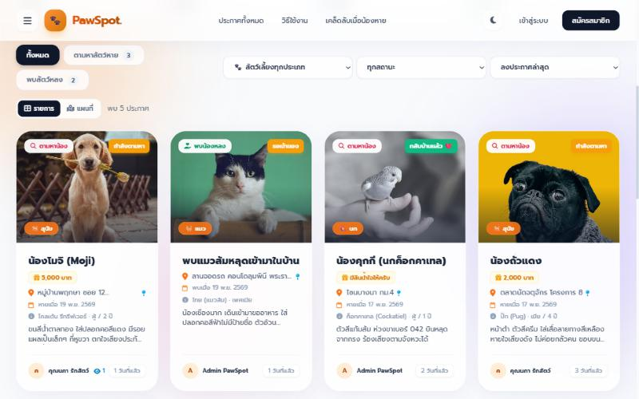 รายการประกาศ |
| 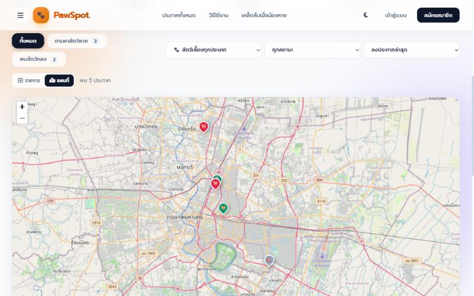 ดูประกาศบนแผนที่ | 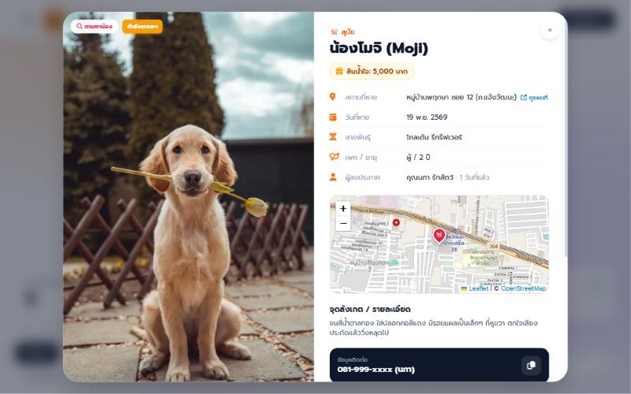 รายละเอียด + แผนที่ |
| 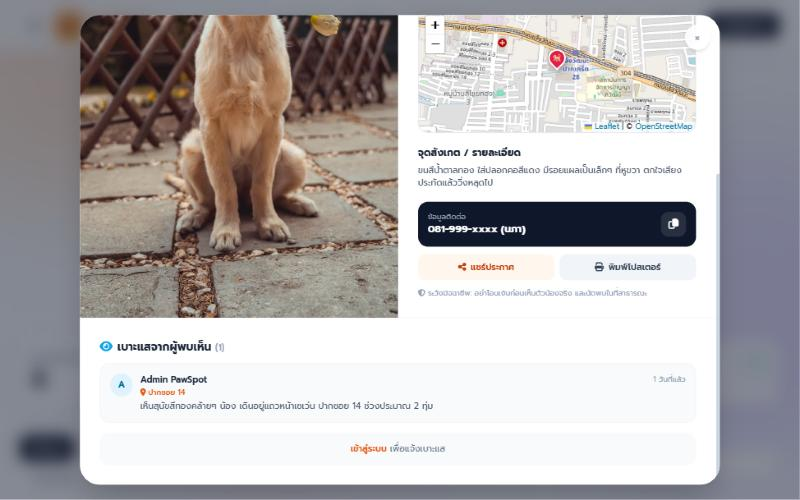 เบาะแสจากผู้พบเห็น |  เข้าสู่ระบบ (รหัสผ่าน / Google / LINE) |
|  เมนู ☰ | 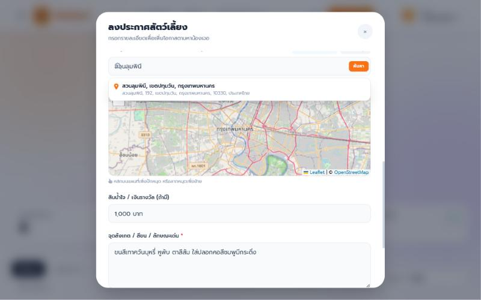 ค้นหาสถานที่ |
| 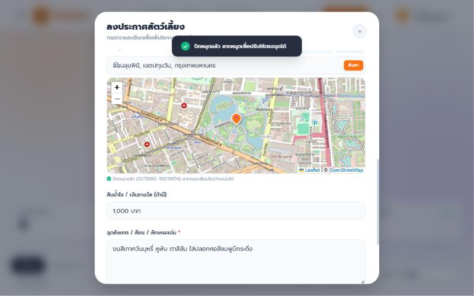 ปักหมุดอัตโนมัติ | 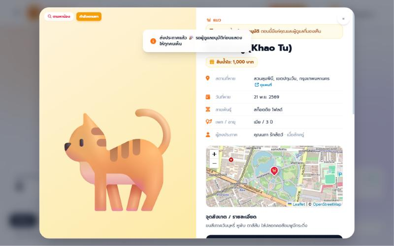 ส่งประกาศ → รออนุมัติ |
| 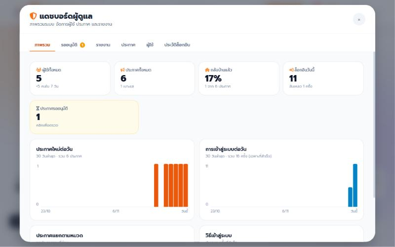 แดชบอร์ดผู้ดูแล | 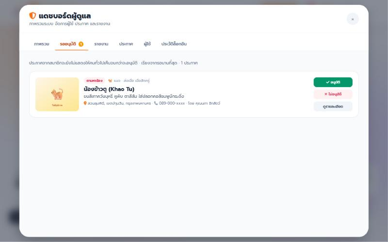 อนุมัติประกาศ |
|  การแจ้งเตือน | 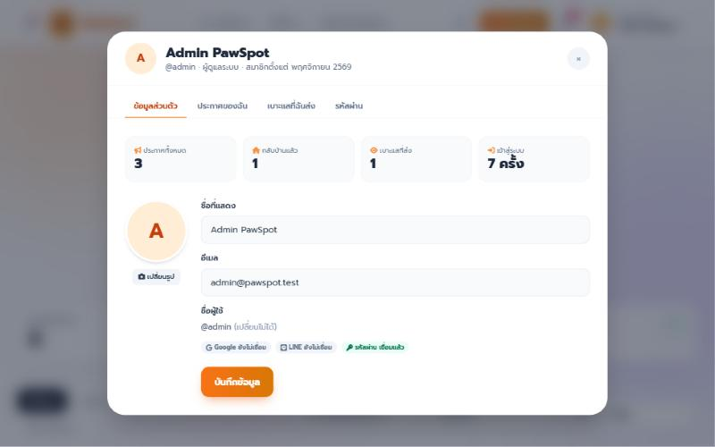 โปรไฟล์ |
| 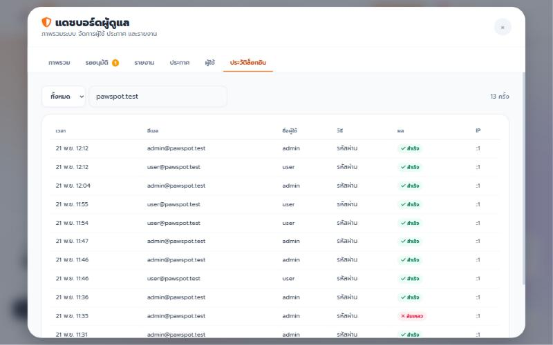 ประวัติการเข้าสู่ระบบ |  โหมดมืด |
| 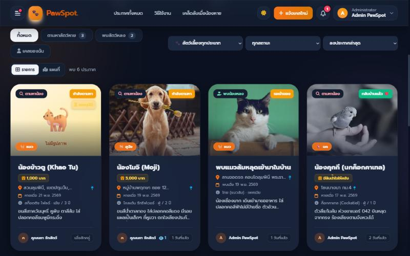 โหมดมืด (รายการ) |  บนมือถือ |

## 11. เข้าสู่ระบบด้วย Google / LINE (ไม่บังคับ)

เว็บใช้งานได้ครบโดยไม่ต้องตั้งค่าส่วนนี้ (ปุ่ม Google/LINE จะเป็นสีจาง) ถ้าต้องการเปิดใช้ ให้สร้างแอปที่ผู้ให้บริการแล้วใส่ค่าใน `.env`

| เจ้า | Callback URL (เครื่องตัวเอง) | ค่าใน `.env` |
|---|---|---|
| Google ([Cloud Console](https://console.cloud.google.com/)) | `http://localhost:3000/api/auth/oauth/google/callback` | `GOOGLE_CLIENT_ID`, `GOOGLE_CLIENT_SECRET` |
| LINE ([LINE Developers](https://developers.line.biz/console/)) | `http://localhost:3000/api/auth/oauth/line/callback` | `LINE_CHANNEL_ID`, `LINE_CHANNEL_SECRET` |

- Google: OAuth consent screen (External + Test users) → Credentials → OAuth client ID แบบ *Web application*
- LINE: สร้าง Provider → channel แบบ **LINE Login** (Web app) → ใส่ Callback URL → Publish
- `ADMIN_EMAILS=อีเมล@...` : ล็อกอินด้วย Google (อีเมลที่ยืนยันแล้ว) ครั้งแรกจะได้สิทธิ์ผู้ดูแลอัตโนมัติ

## 12. ขึ้นเว็บจริง (Render + Neon)

ไฟล์ [`render.yaml`](../render.yaml) ที่ root ของ repo ตั้งค่าไว้แล้ว

1. **Neon**: สร้างโปรเจกต์ region Singapore → คัดลอก connection string (pooled)
2. **Render**: New → **Blueprint** → เลือก repo + branch `pawspot-online` → กรอก `DATABASE_URL`, `PUBLIC_URL`, `ADMIN_EMAILS`, คีย์ Google/LINE
3. เพิ่ม Callback URL ของเว็บจริงใน Google / LINE: `https://<ชื่อเว็บ>.onrender.com/api/auth/oauth/google/callback` (และ `/line/callback`)

แบบฟรี: Render หลับเมื่อไม่มีคนใช้ 15 นาที (เข้าครั้งแรกรอ ~30–50 วินาที), Neon เก็บได้ 0.5 GB

## 13. สรุปผลและแนวทางปรับปรุง

**สรุปผล**
- ได้เว็บแอปที่ใช้งานได้จริงครบวงจร: ลงประกาศ ค้นหา แผนที่ จับคู่อัตโนมัติ เบาะแส แจ้งเตือน ระบบสมาชิก และระบบผู้ดูแล
- แยก Frontend / Backend ชัดเจน ติดต่อกันผ่าน REST API · ข้อมูลเก็บใน PostgreSQL ดูได้ใน pgAdmin
- มีการทดสอบอัตโนมัติ 178 ข้อ และคำนึงถึงความปลอดภัย (bcrypt, JWT, กัน XSS/SQL Injection, อนุมัติประกาศ)

**แนวทางปรับปรุง**
- ยืนยันอีเมลตอนสมัคร และรีเซ็ตรหัสผ่านทางอีเมล
- แชทในเว็บระหว่างผู้พบกับเจ้าของ (ไม่ต้องเปิดเผยเบอร์โทร)
- หลายรูปต่อประกาศ, เก็บรูปบน Cloud Storage แทนฐานข้อมูล
- ติดตั้งเป็นแอปบนมือถือ (PWA) + แจ้งเตือนแบบ push
- ลบบัญชีได้เอง (ตาม PDPA), เตือนประกาศที่ค้างนาน
